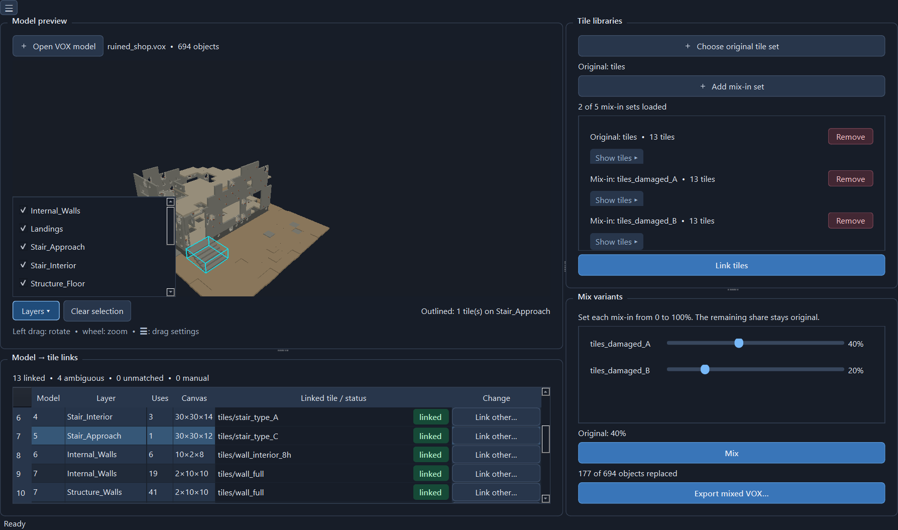

# VOX Tile Mixer v0.11

A Windows desktop app for creating controlled variations of MagicaVoxel `.vox` scenes from folders of alternative tiles. It keeps scene layers, transforms, camera, materials, and unknown chunks while exporting a new native `.vox` file. Each press of **Mix** draws a new variation.

## Quick start

On Windows, run `build_windows.cmd`, then open `dist/VOX Tile Mixer.exe`. For development, install `requirements.txt` and run `python run.py`.

1. Open a native VOX scene with **Open VOX model** (included in `/example` folder).
2. Choose the **original tile set** used to identify scene parts, then add up to five **mix-in sets**. Each folder contains standalone single-model `.vox` tiles. Matching families use the same stem, with optional suffixes such as `_damaged_A`.
3. Press **Link tiles**. Green rows are linked, yellow rows are ambiguous, and red rows are unmatched. Identical geometry may belong to different tiles; use **Link other…** to select a specific tile file and rotation. Several source models can point to the same tile family. Select a row to outline all its instances in the preview; expand **Layers** to hide or show individual scene layers.
4. Set each mix-in percentage from 0 to 100, then press **Mix** to update the preview. Press **Mix** again for a fresh random arrangement. The remaining share stays original. If the mix-in values add up to more than 100, their shares are normalized to 100. Drag with the left mouse button to orbit, use **Clear selection** beside **Layers** to remove tile outlines, and scroll to zoom. Change drag inversion from the ☰ menu.
5. Export to a new `.vox`. The app saves a `.vox.tilemix.json` link file next to both source and export. Reopening either scene loads its saved folders, links and percentages. The exported scene starts with all mix-in sliders at zero because its voxels already contain the mix; the source retains the settings used to create it.

Each scene object makes its own random choice, even when many objects share one original model. A wider damaged tile can expand its model canvas; the app adjusts that object's transform to keep its position. Variants that exceed the MagicaVoxel 256-voxel model limit, need unavailable palette colours, or cannot be placed on an individual object are skipped and reported in the mixer panel tooltip.

The app uses voxel geometry for automatic identification. Equal shapes are deliberately marked **ambiguous** until assigned. A manual link can assign several source models to the same tile family. For all exports, keep the original and review the resulting file in MagicaVoxel before use.

## Tests

`python -m unittest discover -s tests -v`

The repository contains only source and build instructions. PyInstaller writes the local executable to `dist/`; publish that file as a GitHub release if you want others to download it.

---
Made by Max (Imadakara) with Codex, october 2026
